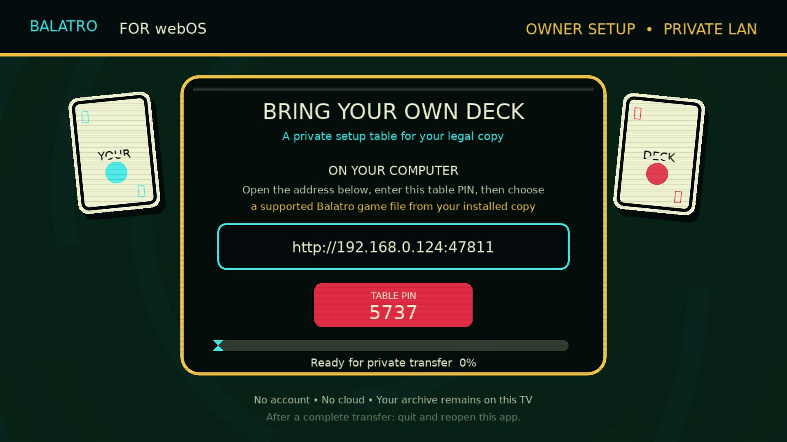
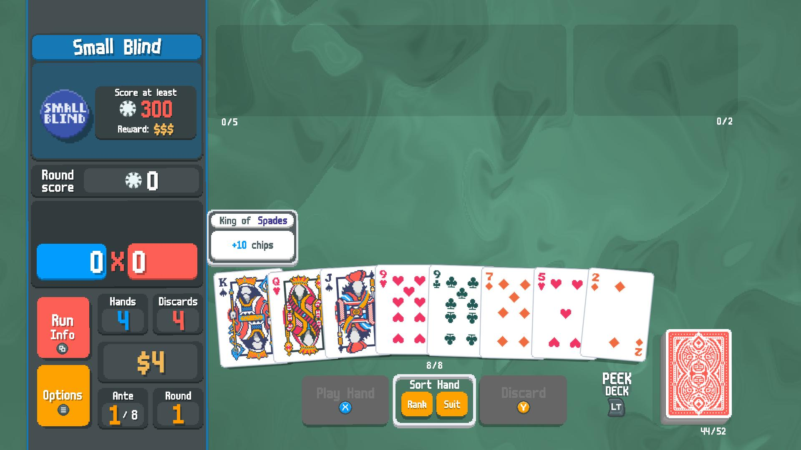
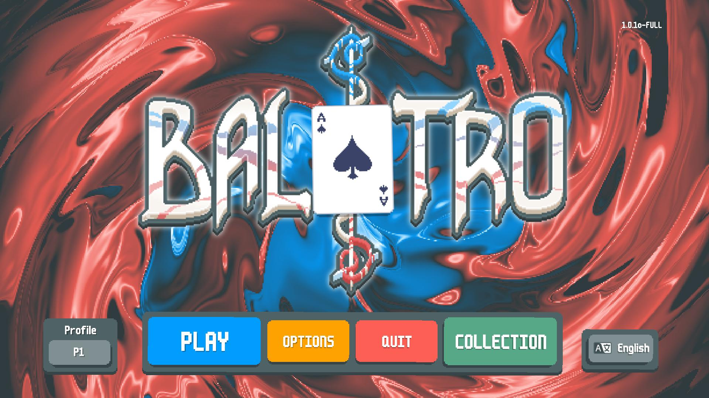

# Balatro for webOS

An unofficial, open-source native launcher for running **your own legally obtained copy of Balatro** on an LG webOS TV.

It is deliberately game-file-free. The release IPK contains no Balatro code, artwork, music, saves, archive, downloader, or cloud service. During first-run setup, the TV shows a local address and a four-digit PIN. From a computer on the same home network, you select a supported file from your installed Steam copy and it transfers directly to the TV.

> This is an independent experimental project. It is not affiliated with LocalThunk, Playstack, Valve, or LG. Do not upload Balatro files to this repository, releases, issues, or pull requests.

## AI assistance disclosure

This project’s code, documentation, and design were created with assistance from AI (OpenAI Codex). The maintainer is responsible for reviewing, testing, and maintaining the project.

## What works today

- Native ARM IPK for LG webOS in Developer Mode.
- First-run local pairing portal with a TV-generated four-digit PIN.
- macOS import of `Balatro.love` from an installed Steam copy.
- Windows/Linux/Steam Deck import of an installed `Balatro.exe` containing the LÖVE archive.
- Magic Remote pointer input, a TV-remote controller fallback, and Bluetooth controllers. A DualSense controller has been tested.
- Local saves and owner-supplied game archive kept in the app's private TV data directory.
- A compatibility shader that prevents the known black U-shaped CRT artifact on the tested TV.

## Screenshots

Direct captures from an LG webOS TV. The game archive shown in the gameplay images is owner-supplied and is not included with this project.

### First-run setup



### Gameplay



### Main menu



## Before you start

- An LG webOS TV with **Developer Mode** enabled.
- A Mac, Windows PC, Linux PC, or Steam Deck on the same home network as the TV.
- Your own installed Steam copy of Balatro.
- The latest `Balatro-for-webOS-v*.ipk` from [Releases](https://github.com/QED18/balatro-webos/releases).

Developer Mode is required for sideloading. Enable it with LG's Developer Mode app, then connect the TV with the webOS CLI or webOS Dev Manager. LG documents the CLI setup and `ares-install` flow in its [Developer Mode guide](https://webostv.developer.lge.com/develop/getting-started/developer-mode-app) and [CLI guide](https://webostv.developer.lge.com/develop/tools/cli-dev-guide).

## Install on the TV

1. Put the TV in Developer Mode and make sure its **Key Server** is on.
2. Install the downloaded IPK with webOS Dev Manager, or use the official webOS CLI:

   ```sh
   npm install --global @webos-tools/cli
   ares-setup-device
   ares-novacom --device YOUR_TV --getkey
   ares-install --device YOUR_TV Balatro-for-webOS-v0.3.12.ipk
   ares-launch --device YOUR_TV io.github.qed18.balatro
   ```

3. Open **Balatro for webOS** on the TV. On a first run it shows a local address and a four-digit PIN.

### Homebrew-assisted setup (macOS)

Homebrew cannot install an app directly onto an LG TV. It can, however, install the command-line prerequisite used to connect to the TV. In Terminal, run:

```sh
brew install node
npm install --global @webos-tools/cli
curl -L -O https://github.com/QED18/balatro-webos/releases/download/v0.3.12/Balatro-for-webOS-v0.3.12.ipk
shasum -a 256 Balatro-for-webOS-v0.3.12.ipk
```

Check that the checksum is:

```text
cb7d14a27b8d3817f5a86c87c901c5d99cc02522d52cc1d0baf7db7fa7ea22bb
```

Then follow the commands in **Install on the TV** above: `ares-setup-device`, `ares-novacom --device YOUR_TV --getkey`, and `ares-install`.

### Adding a `brew install` command later

The right Homebrew distribution method is an independent **tap**, not an official Homebrew cask: this release is an LG TV IPK, not a macOS app. A tap such as `QED18/homebrew-tap` can provide a small formula that downloads this IPK and prints its installed path for `ares-install`. It does not remove the need for LG Developer Mode or the TV pairing step.

Once that separate tap exists, users could install it with a single command like:

```sh
brew install QED18/tap/balatro-webos
```

That requires creating and maintaining the `QED18/homebrew-tap` repository and updating its formula's version, URL, and SHA-256 for every release.

## webOS Homebrew Channel

For TVs that already run the **webOS Homebrew Channel**, this project also provides a small personal repository while its listing is reviewed for the official webOSbrew catalog.

1. Open **Homebrew Channel** on the TV.
2. Open **Settings** and choose **Add Repository**.
3. Enter this address:

   ```text
   https://github.com/QED18/balatro-webos/releases/latest/download/apps.json
   ```

4. Return to the catalog and choose **Balatro for webOS**.

The launcher itself does not require root access and still contains no Balatro files. Homebrew Channel is a separate community installer; its availability and installation requirements depend on your TV and webOSbrew setup.

## Bring your own game file

On your computer, open the exact address shown on the TV. Enter the TV PIN, choose your platform, and use the matching steps shown by the portal.

### macOS

1. In Steam, right-click **Balatro** and choose **Manage → Browse local files**.
2. Right-click `Balatro.app`, choose **Show Package Contents**, then open `Contents/Resources`.
3. Drag `Balatro.love` onto the portal, or click the drop area and select it.
4. Select **Verify & Transfer**. When it says complete, quit and reopen the TV app.

### Windows, Linux, and Steam Deck

1. In Steam, right-click **Balatro** and choose **Manage → Browse local files**.
2. Drag `Balatro.exe` from that folder onto the portal, or click the drop area and select it.
3. Select **Verify & Transfer**. When it says complete, quit and reopen the TV app.

On Linux or Steam Deck, use this route only when the local installed game folder contains `Balatro.exe` (for example, a Proton install). The portal extracts the embedded LÖVE archive locally on the TV; it does not upload it anywhere else.

## Controls

- **Recommended:** pair a Bluetooth controller, such as a DualSense.
- **Magic Remote:** use the pointer and click the on-screen controls.
- **Remote fallback:** arrow keys map to the virtual D-pad; OK/Green maps to A; Back/Red maps to B.

The launcher leaves webOS's normal Magic Remote cursor timeout unchanged. Any wake-up delay after a long period of remote inactivity is handled by the TV firmware, not by the file transfer.

> **Important:** fully exit Balatro before returning to the webOS Home screen or using other TV apps and functions. Press and hold **Back/Return** for about three seconds (or press **Exit**, if your remote has it). Sending the game to Home only leaves it running in the background, which can make Home and the rest of the TV temporarily sluggish.

## Privacy and safety

- The portal listens only while the setup screen is open and displays a local-network URL.
- Files go directly from your computer to the TV. There is no account, cloud upload, telemetry, or game-file download.
- Never port-forward the TV or expose the pairing address to the Internet.
- The portal checks the four-digit PIN, maximum file size, ZIP directory, safe archive paths, and that `main.lua` is at the archive root. It is intended for a trusted home network, not as an Internet-facing file service.

## Known limitations

- This is an experimental sideloaded app, not an LG Content Store release.
- Developer Mode sessions expire; LG may remove sideloaded apps when Developer Mode is disabled or expires.
- The original CRT warp shader is replaced on the tested TV to avoid the black U-shaped rendering bug, so its visual effect is not identical to the desktop game.
- Only macOS `Balatro.love` and Windows-format `Balatro.exe` are accepted. A macOS `.app` bundle cannot be traversed by a browser file picker, so select the `.love` file inside it.

## Build from source

Builds are supported on Linux x86_64 with the webOSbrew Buildroot SDK and the webOS CLI installed:

```sh
export WEBOS_SDK=/absolute/path/to/arm-webos-linux-gnueabi_sdk-buildroot
python3 scripts/verify-source.py
native/scripts/build-webos.sh
```

The resulting package is placed in `dist/`. The build pins the Webmon dependency recipe and packages LÖVE 11.5 plus the runtime libraries it requires. See [architecture](docs/ARCHITECTURE.md), [portal details](docs/PORTAL.md), and [third-party notices](THIRD_PARTY_NOTICES.md).

## Contributing

Issues, TV compatibility reports, documentation fixes, and code contributions are welcome. Please include TV model, webOS version, controller, and a redacted error message when reporting a bug. Never attach copyrighted game files or personal save data.

## License

Project-authored code is [MIT licensed](LICENSE). Runtime components included in a built IPK have their own licenses; see [THIRD_PARTY_NOTICES.md](THIRD_PARTY_NOTICES.md).
